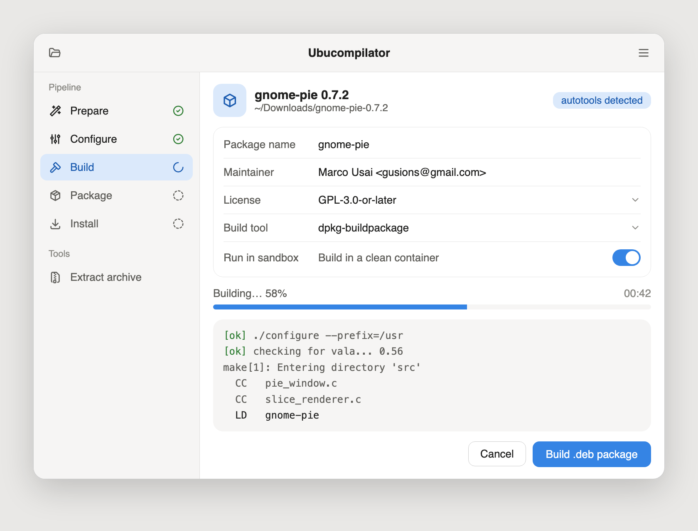

# Ubucompilator

> **A graphical tool that compiles a source tree and packages it as a `.deb`, without touching the terminal.**

---

## ⚠️ Historical / archived project

Ubucompilator is a **2009–2010 project** and is **no longer maintained**.

- Active development: October 2010 (latest version in this repo: **0.99.2**; the Launchpad branch was marked "Stable version 1.0" in August 2011).
- It was written in **Gambas 2**, a BASIC development environment for Linux that is now obsolete.
- It depends on tools that no longer exist on modern distributions (e.g. `gksudo`).
- The repository is kept online **for archival and historical documentation purposes**. **It is not meant to be used today.**

---

## What it is

Compiling a program from source and building a `.deb` package requires knowing a chain of commands (`./configure`, `make`, `dh_make`, `debuild`...). Ubucompilator put that chain **behind a window with buttons**, aimed at people new to Ubuntu/Linux who did not know how to use the shell.

Main features:

| Step | Command run | Purpose |
|------|-------------|---------|
| 1 | `./autogen.sh` | Generates the `configure` script (if the source provides it) |
| 2 | `./configure` | Checks dependencies and prepares the build |
| 3 | `make` | Compiles the program |
| 4 | `gksudo make install` | Installs the program on the system |
| 5 | `dh_make -s -e <email> -n --copyright gpl` | Creates the package's `debian/` directory |
| 6 | `debuild binary` | Builds the binary `.deb` package |
| 7 | `xterm checkinstall` | Alternative: builds the `.deb` with CheckInstall |

Also included:
- a folder chooser to pick the source directory;
- a text area showing the output of each command;
- **Unziptool**: a small extractor for `.zip`, `.tar.gz` and `.tar.bz2` archives;
- a system tray icon, plus *About*, *License* and *Credits* windows;
- an Italian interface (with a few English labels).

---

## Why it made sense at the time

Ubucompilator was born in 2009–2010, when Ubuntu was winning over a wave of newcomers from Windows. For many of them the terminal was the biggest barrier to entry, and the software they wanted was often out of reach through the normal channels.

**The software you wanted was often not packaged.**
- In 2010 there was no Snap, no Flatpak, no AppImage culture and no one-click app store for third-party software. The Ubuntu Software Center only offered what was in the repositories.
- Many programs, especially new releases, small projects and niche tools, were distributed **only as a source tarball** (`.tar.gz`, `.tar.bz2`, `.zip`). Packages in the official repositories were frozen at release time, so the version you read about in a blog post was usually newer than the one you could install.
- PPAs on Launchpad helped, but they relied on someone else having built the package for *your* Ubuntu release and architecture. When nobody had, the only answer on forums was: "download the source and run `./configure && make && sudo make install`".

**That answer was a wall for beginners.**
- Compiling meant installing the right toolchain, reading `README` and `INSTALL` files, spotting missing `-dev` libraries from cryptic errors, and typing commands in the right order in the right folder.
- One wrong step and nothing worked, with no hint about what to do next.

**Ubucompilator turned that into a few clicks.**
- Pick the extracted folder, press the buttons in order and watch the output in the window.
- Unziptool handled the extraction, so the whole path from *downloaded tarball* to *installable program* stayed in one window.

**It produced a `.deb`, not just a mess of files.**
This is the part that mattered most. A bare `make install` scatters files across the system, and nothing tracks them: you can't cleanly uninstall, upgrade or see what got installed. Wrapping the result in a `.deb` (via `dh_make`/`debuild` or `checkinstall`) gave newcomers the things Ubuntu users already knew:
- install by double-clicking the file, with dependency handling by the package manager;
- uninstall from Synaptic or the Software Center, leaving the system clean;
- an actual package they could keep, copy to another computer or share with friends.

**A native build, tuned to the user's own system.**
Compiling on the user's machine meant the binary was linked against the libraries of their own Ubuntu release and built for their own CPU, instead of relying on a generic binary made for someone else's setup. That is also why a `.deb` built locally often worked when a downloaded one for a different release did not.

**It taught without lecturing.**
The buttons followed the real order of the build chain, and the output pane showed what each step did. A curious user could learn what `configure`, `make` and `debuild` were by watching, and graduate to the terminal when they felt ready. The goal was never to hide Linux, only to lower the first step.

In short: at a time when "not in the repositories" meant "not for you" if you couldn't use a shell, Ubucompilator let a beginner get that software installed, cleanly and reversibly, in a few clicks.

---

## How it worked

```
┌───────────────────────────────┐
│ 1. Pick the source directory  │
└──────────────┬────────────────┘
               ▼
 autogen → configure → make → (make install)
               ▼
 dh_make → debuild binary   or   checkinstall
               ▼
          .deb package
```

Each button runs **a single command** in the chosen directory and shows its output. The order of the steps is up to the user.

---

## Repository layout

```
Ubucompilator/
├── Ubucompilator/           # Gambas project (readable source)
│   ├── FMain.class / .form  # Main window and build logic
│   ├── FUNZIP.class / .form # Archive extractor
│   ├── FAbout, Licenza, Riconoscimenti
│   ├── Immagini/            # Icons, splash, logos
│   └── .project             # Gambas metadata (version, libraries)
├── configure.ac, Makefile.am, acinclude.m4, ...   # autotools scaffolding
├── AUTHORS, ChangeLog, COPYING, INSTALL, NEWS, README
└── README.md                # This file
```

> Gambas `.class` and `.form` files are **not binaries**: they are plain-text source.

**Stack:** Gambas 2.21 · GTK (`gb.gui`, `gb.form`, `gb.compress`, `gb.desktop`, `gb.image`) · autotools.

---

## Original requirements

- Ubuntu (or a Debian derivative) of the time, roughly 10.04–11.04
- Gambas 2 runtime (`gambas2-runtime` plus the libraries listed above)
- `build-essential`, `dh-make`, `devscripts`, `checkinstall`, `xterm`, `gksu`
- The source code of the program to build, with its own build dependencies

---

## Installation (historical)

Building the project required a Gambas 2 environment:

```bash
./configure
make
sudo make install
```

or opening the `Ubucompilator/` folder directly in the Gambas 2 IDE and running it.

> On modern systems **it will not work**: Gambas 2 is no longer in the repositories and `gksudo` has been removed.

---

## Historical links

| Resource | Link |
|----------|------|
| Launchpad project | https://launchpad.net/ubucompilator |
| Development branch (Bazaar) | https://code.launchpad.net/ubucompilator — `bzr branch lp:ubucompilator` |
| Bug tracker (Launchpad) | https://bugs.launchpad.net/ubucompilator |
| Google Code archive | https://code.google.com/archive/p/ubucompilator |
| Official project blog | https://ubucompilator.wordpress.com |
| Ask Ubuntu: "GUI for configure, make, make install" | https://askubuntu.com/questions/42994/gui-for-configure-make-make-install |
| WebUpd8: "Ubucompilator Easy .deb Creator 1.0 Beta" (2010) | http://www.webupd8.org/2010/10/ubucompilator-easy-deb-creator-10-beta.html |
| Genbeta article (ES) | https://www.genbeta.com/linux/compila-tus-programas-en-paquetes-deb-con-ubucompilator |
| This repository | https://github.com/Gusions/Ubucompilator |

Several mirrors derived from the Google Code export also exist on GitHub (e.g. `alpaslan2004/ubucompilator`, `ttsudipto/ubucompilator`, `sakib336/ubucompilator`).

> Some historical links may be outdated or unreachable.

---

## Modern redesign concept

A mockup of how Ubucompilator could look today as a GTK4 / libadwaita app: a single build pipeline instead of seven separate buttons, project auto-detection, a non-blocking live log and an optional clean-container build.



> Concept only: this is a design mockup, not working code.

---

## Modern alternatives

If you want to build a `.deb` from source today:

- [`dpkg-buildpackage`](https://manpages.debian.org/dpkg-buildpackage) / `debuild` with a hand-written `debian/` directory
- [`checkinstall`](https://wiki.debian.org/CheckInstall) for quick packages from `make install`
- [`fpm`](https://github.com/jordansissel/fpm) to generate packages from directories or other formats
- Debian guide: [Debian New Maintainers' Guide](https://www.debian.org/doc/manuals/maint-guide/)

---

## Author and license

**Marco Usai (Gusions)** — © 2009–2010

Distributed under the **GNU General Public License (GPL)**. See [`COPYING`](COPYING).

---

## Contributing

The project is archived and no further maintenance is planned. You are, however, free to **fork** it: a modern rewrite (for example in Python + GTK4, using `subprocess` without a shell and `pkexec` instead of `gksudo`) would be the most sensible way to revive it.
